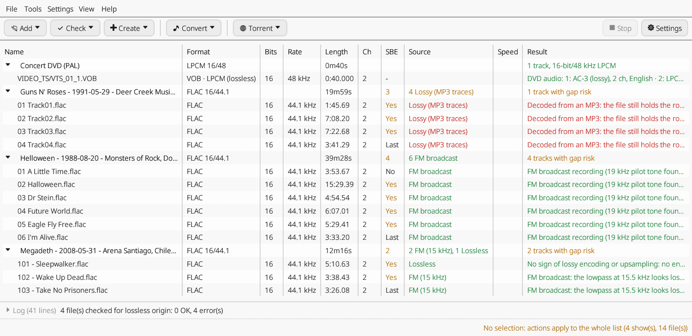

# Bootleg Toolbox

A desktop tool for collectors of lossless concert recordings: checksums, decode tests,
torrents for the trading trackers, format conversions and SBE fixing, in one program.
A modern, open-source take on Trader's Little Helper.

For a detailed description of every feature and a comparison with Trader's Little Helper,
see the [overview](docs/OVERVIEW.md).



**One executable for Windows and Linux. Nothing else to install:** no flac, shntool,
ffmpeg or LAME. Every decoder and encoder is built in.

## Features

- **Reads** FLAC, WAV (integer and float), AIFF, SHN (Shorten), APE (Monkey's Audio 3.95
  and later), WavPack and ALAC (lossless), MP3, MP2, AAC and Ogg Vorbis (always flagged as
  lossy), the M4A, MKA and Ogg containers (AAC, ALAC, FLAC, MP2, MP3, PCM, Vorbis inside;
  AC-3 and Opus not yet), the audio track of MP4 concert videos, and DVD-Video folders.
- **File details**: format, length, CD-readiness, MD5 signature, sector boundary errors
  (SBE), for every track and every show.
- **Checksums**: verifies and creates `.ffp` (FLAC fingerprints), `.st5` (MD5 of the
  decoded audio, as shntool), `.md5` and `.sfv` (whole files). Reads files written on Windows
  (`\` paths, other letter case, Windows-1252 names).
- **Decode test**: decodes every file in full and reports damaged or truncated ones.
- **Torrents** for DIME and The Traders' Den (private, one `source` per tracker so both
  can be seeded), and for any other tracker you add.
- **Torrent check**: checks a show against its `.torrent`, piece by piece, and names the
  damaged, missing and extra files (drop the `.torrent` on the window).
- **Conversions**: to FLAC (levels 0 to 8, each file decoded again and checked), to WAV,
  and MP3 copies (320 kbps CBR or VBR V0) in a separate folder, with tags, text files and
  artwork. After a conversion to FLAC, a window offers to move the originals and the old
  checksum files to the trash and to create the new FFP.
- **SBE fix**, disc by disc: the same audio as `shntool fix`, written as FLAC copies in an
  `SBE-fixed` folder.
- **Lossless?**: a spectral analysis that spots lossy sources (MP3/AAC transcodes),
  upsampled audio, 16-bit audio in 24-bit files (also after a level change), lossyWAV
  files and FM broadcasts, plus a search for MP3 and AAC coding traces with the encoders' own
  transforms that catches MP3s and AACs up to 320 kbps; with a full report of the measurements and the
  reasoning.
- **Speed?**: estimates whether a tape runs too fast or too slow (FM pilot tone, tuning
  against A440, mains hum), with the correction to apply.
- **Spectrograms**, to copy or save as PNG.
- **WAV clean-up**: canonical headers (extra chunks, wrong sizes, stray bytes removed),
  audio untouched, in a `WAV-cleaned` folder.
- **Media info**: a MediaInfo-style summary of a show's files or of a DVD (video standard,
  resolution, bit rates, audio tracks marked lossless or lossy, subtitles, titles and
  chapters), as text to copy into a forum post or an info file. DVDs join the list, one
  row per title, with each audio track's codec (LPCM, AC-3, DTS, MPEG) marked lossless or
  lossy; **Extract DVD audio** saves the track you pick, from all the title's VOB files, as
  one FLAC file (LPCM, bit for bit) or as its original stream (lossy codecs).
- **Tag and rename from the info file**: the artist, date, place and titles are read from
  the show's text file (numbered or plain tracklists, discs and sets, "Artist:" fields),
  shown in a window to check and correct, then written as FLAC tags; the files can be
  renamed ("01 - Title", "d1t01 - Title" or eTree style), or only renamed. The audio is not
  touched, so FFP and ST5 stay valid; `.md5` and `.sfv` lines are computed again, and new
  names are carried into every checksum file. Several shows at once: the clear ones are
  ready to go, the doubtful ones are checked one by one. **Tools > Undo tagging** gives the
  files back byte for byte (30 days).
- **Setlists from setlist.fm** (with your own free API key, in Settings): the setlist of
  each show is written in its folder as "Artist - YYYY-MM-DD - Venue, City, Country.txt"
  (tour and numbered songs), ready for Tag and rename; when setlist.fm has several shows
  that day, the venue in the folder name decides, or you choose. The Tag and rename window
  can also take its titles straight from setlist.fm.
- **Upload helpers**: copy a show's FFP or its info file to the clipboard.
- **File manager integration** (optional): "Open in Bootleg Toolbox" in the right-click
  menu of Explorer, Dolphin, Nautilus and Nemo.

Conversions, MP3 copies, SBE fixes and cleaned WAVs are written next to the originals,
which are never changed. Only "Tag and rename from info file" changes files in place, after
you have checked what it will write: tags and names only, never the audio, and it can be
undone.

The program makes no network connection unless you ask for one: to check for a new
version (Help > Check for updates, or the Settings option, off by default), it asks
github.com for the latest release, sending nothing but its name and version; to get a
setlist, it asks setlist.fm with your API key, the artist and the date of the show.

## Download

Ready-to-run executables for Windows and Linux are on the Releases page of this
repository. On Windows, run `bootleg-toolbox.exe`; on Linux, make the file executable
(`chmod +x bootleg-toolbox`) and run it. To add it, with its icon, to your desktop's applications
menu, use **Help > Add to the applications menu** (again if you move the file).

Each release lists the SHA-256 checksums of both files. Windows executables are to be
code-signed through SignPath: see the [code signing policy](#code-signing-policy).

## Usage

Drag folders or files onto the window (hold Ctrl to add to the list instead of replacing
it), or use **Add**. A show is a folder; its `CD1`, `CD2`, `Disc 2`, `Set 1`... sub-folders
are its discs. Select shows or tracks (click, Ctrl/Shift+click, or drag over the rows);
with no selection, actions apply to the whole list. Every action is in the toolbar, in the
**Tools** menu and on right-click.

### Command line

The same operations run without a window, for scripts:

```
bootleg-toolbox --cli <command> <folders or files...>
```

| Command | Action |
| --- | --- |
| `details` | File details |
| `verify` | Verify checksum files |
| `create` | Create checksum files (`BT_OVERWRITE=1` to replace, `BT_MD5=1` to add `.md5`, `BT_SFV=1` to add `.sfv`) |
| `test` | Decode test |
| `torrent-dime`, `torrent-ttd`, `torrent-both` | Torrents for DIME, TTD, or both |
| `torrent-all` | Torrents for DIME, TTD and the trackers in `BT_TRACKERS="Name=announce;..."` |
| `lossless`, `speed` | Lossless and speed analyses (`BT_REPORT=1` for the full report) |
| `spectrogram` | Spectrograms, saved as PNG in the current folder |
| `to-flac`, `to-wav` | Conversions (`BT_LEVEL=0`...`8` for FLAC, 8 by default; `BT_FLOAT=round` rounds float WAVs to 24 bits) |
| `mp3-320`, `mp3-v0` | MP3 copies (`BT_MP3_DIR` for another folder) |
| `fix-sbe` | SBE fix |
| `clean-wav` | WAV clean-up |
| `tag-info` | Tag and rename the FLAC files from the info file (`BT_RENAME=number`, `disc`, `etree` or `keep`; `BT_DRY=1` only prints what it read) |
| `undo-tagging` | Roll back the latest Tag and rename: former tags, names and checksum files, byte for byte |
| `setlist` | Write the setlist of each show from setlist.fm in its folder (`BT_SETLISTFM_KEY` = your API key) |
| `extract-dvd` | Extract one audio track of each DVD title to one file beside the DVD: FLAC for LPCM, the original stream for AC-3, DTS and MPEG audio (`BT_TRACK=n`) |
| `torrent-check` | Check the `.torrent` files given against their shows |
| `media-info` | Media info of the shows and of the DVDs (`VIDEO_TS` folders, VOB files) |
| `check-update` | Look for a newer release |
| `shell-menu-add`, `shell-menu-remove` | Add or remove the file manager entry |
| `help` | Every command, variable and keyboard shortcut (also `bootleg-toolbox --help`, and Help > Keyboard shortcuts and command line, F1, in the window) |

## Building from source

With a stable Rust toolchain (https://rustup.rs) and a C compiler (for LAME):

```
cargo build --release
```

The program is `target/release/bootleg-toolbox`. On Linux, building LAME also needs
`make`; no other development package is required (the X11, Wayland and OpenGL libraries
are loaded at run time).

To build the Windows executable from Linux, with the MinGW-w64 cross compiler installed:

```
rustup target add x86_64-pc-windows-gnu
cargo build --release --target x86_64-pc-windows-gnu
```

## Code signing policy

Free code signing provided by [SignPath.io](https://about.signpath.io/), certificate by
[SignPath Foundation](https://signpath.org/). The application to the SignPath Foundation
is in progress: until it is accepted, the Windows executables are not signed.

- Only executables built by GitHub Actions from this repository, by the
  [build workflow](.github/workflows/build.yml), are submitted for signing; nothing built
  on a personal computer is ever signed.
- Every signing request is approved by hand, release by release.
- Team roles:
  - Committers and reviewers: [Rattlehead80](https://github.com/rattlehead80)
  - Approvers: [Rattlehead80](https://github.com/rattlehead80)

### Privacy

This program will not transfer any information to other networked systems unless
specifically requested by the user or the person installing or operating it.

The program connects to the network only when the user asks for it: the update check, off
by default (Help > Check for updates, or the Settings option), asks github.com for the
latest release, sending nothing but its name and version; Get setlist from setlist.fm and
the Tag and rename window's setlist.fm button send the user's own setlist.fm API key, the
artist and the date of the show to api.setlist.fm.

## Licence

Copyright (C) 2026 Rattlehead80

This program is free software: you can redistribute it and/or modify it under the terms
of the GNU General Public License as published by the Free Software Foundation, either
version 3 of the License, or (at your option) any later version. See [LICENSE](LICENSE).

It includes LAME (LGPL) and other open-source components: see
[THIRD-PARTY.md](THIRD-PARTY.md).

Trader's Little Helper is a separate, closed-source freeware program; Bootleg Toolbox
shares no code with it.
